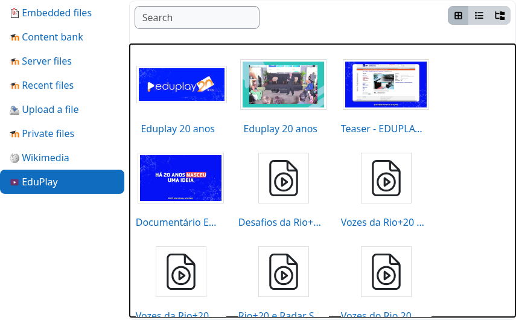

moodle-repository_eduplay
=========================

.. PITCH-BEGIN (generated by workspace/docs/tools/pitch_docs.py; edit there)

**Encontre o vídeo do EduPlay pelo título sem sair do Moodle.**

   Pesquisando "Documentário Eduplay 20 anos" no repositório EduPlay do seletor de arquivos.

* **Chega de caçar links.** Digite palavras do título no seletor de arquivos e veja os vídeos correspondentes com miniatura.
* **Escolher, não copiar.** O vídeo entra como link: nada é enviado ao Moodle e o vídeo continua no EduPlay.
* **Só o que o professor pode usar.** Vídeos públicos e ativos que não exigem login.
* **Opcional por construção.** Uma configuração desliga toda requisição ao EduPlay; links colados continuam funcionando.

Veja em 30 segundos
-------------------

.. raw:: html

   <video controls preload="none" style="width:100%;max-width:960px" aria-label="Veja em 30 segundos">
     <source src="https://eduplay-moodle-suite.github.io/media/repository.mp4" type="video/mp4">
     <a href="https://eduplay-moodle-suite.github.io/media/repository.mp4">MP4</a>
   </video>

*Abrir o seletor de arquivos pelo editor, pesquisar pelo título e escolher um vídeo (interface do Moodle em inglês).*

Comece em três passos
---------------------

1. Instale o ``local_eduplay`` e o ``repository_eduplay`` (:doc:`installation`) e habilite o repositório **EduPlay**.
2. Em um editor, abra *Multimídia* > *Procurar repositórios* > **EduPlay**.
3. Digite o título e escolha o vídeo.

Colar um link completo na caixa de busca também funciona, e então mostra o título e a miniatura reais.

.. PITCH-END

O que é
-------

O **moodle-repository_eduplay** é um repositório do seletor de arquivos do Moodle para o EduPlay, no estilo do repositório Wikimedia: o autor **pesquisa vídeos do EduPlay pelo título**, vê os resultados com a miniatura e escolhe um. O vídeo é inserido como **link externo** (nunca uma cópia da mídia), que o `moodle-media_eduplay <https://eduplay-moodle-suite.github.io/moodle-media_eduplay/>`_ exibe como o player oficial. Colar o link completo do vídeo na busca também funciona. Faz parte da **EduPlay Moodle Suite** (não oficial) e depende do `moodle-local_eduplay <https://eduplay-moodle-suite.github.io/moodle-local_eduplay/>`_, que consulta a API pública do EduPlay.

English version: `English <../en/index.html>`_.

.. warning::

   Este projeto não é oficial. Não possui afiliação, endosso ou representação da RNP, do EduPlay ou do Moodle HQ. A API do EduPlay que ele usa é pública, mas **não é documentada**, então pode mudar sem aviso.

.. toctree::
   :maxdepth: 2
   :caption: Conteúdo

   installation
   configuration
   usage

Principais recursos
-------------------

* **Busca por título**, 10 resultados por página, com título e miniatura.
* **Somente vídeos públicos**: vídeos ativos, públicos e que não exigem autenticação.
* **Somente link**: o repositório devolve o link canônico (``FILE_EXTERNAL``); nenhuma mídia é copiada para o Moodle.
* **Links colados** continuam aceitos e agora mostram o título e a miniatura reais.
* **Pode ser desligado**: a configuração *Consultar o serviço EduPlay* do ``local_eduplay`` desliga toda requisição ao EduPlay; então só funcionam links colados.
* **Moodle 4.5 LTS e 5.3 LTS**.
